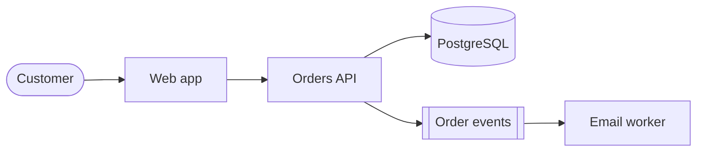

An architect does not pick the best technology. An architect picks the least bad trade-off for a specific situation, writes down why, and makes it cheap to change when the situation changes.

@concept Requirements before technology
@plain
A design starts from what the system must do and how well it must do it, not from a favourite tool. Functional requirements say what. Quality attributes say how well: speed, uptime, security, cost, ease of change.
@problem
Teams that start from a tool find reasons to justify it, and discover missing requirements only after launch.
@does
- Capture functional needs as user stories or use cases.
- Capture quality attributes as measurable statements, such as "95 percent of requests under 300 ms" or "recovery within 1 hour".
- Capture constraints you cannot change: budget, regulation, existing contracts, team skills, deadline.
- Rank the quality attributes. You cannot maximise all of them, and the ranking drives every later choice.
@diagram flow
caption: From need to design
numbered: true
nodes:
  - "Business goal|why the system exists|plain"
  - "Requirements|functional and quality|info"
  - "Constraints|budget, rules, skills|warn"
  - "Options|two or three candidates|app"
  - "Decision|recorded with reasons|ok"
@h A measurable quality attribute
```yaml title="quality-attributes.yaml" nocheck
availability: 99.9 percent monthly
latency_p95_ms: 300
recovery_time_hours: 1
data_loss_minutes: 15
budget_per_month_usd: 5000
team_skills: [kubernetes, postgres]
```
@check
Why rank quality attributes? || They conflict, so the ranking decides which trade-off wins.
@end

@concept Trade-offs and the cost of choices
@plain
Every option gains something and loses something. The job is to make the exchange visible so people can agree on it.
@problem
Hidden trade-offs turn into surprises: a cheap design that cannot meet its uptime target, or a resilient one nobody can afford.
@does
- Common tensions: cost against availability, speed of delivery against flexibility, consistency against latency, control against operational effort.
- Compare options on the same small set of criteria, not on feature lists.
- Prefer boring, well-understood technology unless a requirement forces otherwise.
- Count the total cost: build, run, learn, migrate away.
@diagram cmp
caption: Two common poles
cards:
  - {h: "Managed service", kind: ok, items: ["Less operations work", "Faster start", "Less control and some lock-in"]}
  - {h: "Self-managed", kind: warn, items: ["Full control", "Portable", "You own patching, backups, failover"]}
@h A small weighted scorecard
Weights add to 10. Scores run 1 to 5. Multiply and add.

| Criterion | Weight | Managed DB | Self-run DB |
|---|---|---|---|
| Operations effort | 4 | 5 (20) | 2 (8) |
| Cost at current scale | 3 | 3 (9) | 4 (12) |
| Control | 1 | 2 (2) | 5 (5) |
| Portability | 2 | 3 (6) | 5 (10) |
| **Total** | 10 | **37** | **35** |

The scores are only a conversation aid. Change the weights and the answer changes, which is the point: argue about weights, not about brands.
@check
What does a weighted scorecard make visible? || The criteria and weights behind a choice, so people can disagree openly.
@end

@concept Reversible and irreversible decisions
@plain
Some choices are two-way doors that cost little to undo. Others are one-way doors that are expensive to reverse. Spend deliberation in proportion.
@problem
Teams either agonise over trivial reversible choices or rush the ones that lock them in for years.
@does
- Reversible: instance size, a library, a dashboard layout. Decide fast, measure, adjust.
- Hard to reverse: primary data store, cloud provider for the core platform, account and network layout, public API contracts, address ranges.
- For one-way doors, run a short prototype and review with others.
- Add seams, such as interfaces and infrastructure as code, that lower the cost of change.
@diagram layers
caption: Effort follows reversibility
layers:
  - {label: "One-way doors, decide carefully", nodes: ["Data store|migration is slow|bad", "Network ranges|renumbering hurts|bad", "Public API|clients depend on it|warn"]}
  - {label: "Two-way doors, decide quickly", nodes: ["Instance size|resize later|ok", "Library|swap in a sprint|ok", "Dashboard|edit anytime|ok"]}
@choose How much process
Quick decision in chat | easily reversed, one team | other teams depend on it
Short written ADR | affects several people | it is a trivial local choice
ADR plus prototype and review | one-way door | the team has already tested it in production
@check
Name a one-way door in cloud design. || The primary data store, network address plan or public API contract.
@end

@concept What an architecture decision record is
@plain
An ADR is a short document, usually one page, that records one decision: the context, the options, the choice and its consequences. It is kept in version control beside the code.
@problem
Six months later nobody remembers why a choice was made, so people either fear changing it or repeat the same debate.
@does
- One decision per record, numbered in order, never deleted. A later record can supersede an earlier one.
- Status values: proposed, accepted, deprecated, superseded.
- Written in plain language with the reasons and the trade-offs, including what you gave up.
- Reviewed like code, through a pull request.
@diagram flow
caption: Life of an ADR
nodes:
  - "Proposed|pull request opened|info"
  - "Reviewed|comments and changes|warn"
  - "Accepted|merged to main|ok"
  - "Superseded|new ADR replaces it|plain"
@h Template
```markdown title="docs/adr/0007-use-managed-postgres.md" nocheck
# 7. Use managed PostgreSQL for orders

Status: Accepted (2026-10-31)

## Context
Orders need transactions and reporting. The team has two engineers and no database operator.
Availability target is 99.9 percent. Budget is 800 USD per month for the database.

## Options considered
1. Managed PostgreSQL with a standby in a second zone
2. PostgreSQL on VMs run by the team
3. A document database

## Decision
Option 1.

## Consequences
- Good: backups, patching and failover are handled by the provider.
- Bad: limited extension list, some lock-in to the provider tooling.
- Revisit if monthly cost passes 2000 USD or we need an unsupported extension.
```
@check
Why keep ADRs in the repository? || They are versioned, reviewed and found next to the code they explain.
@end

@concept Writing a good ADR
@plain
A good ADR is short, honest about the downsides, and written for a reader who was not in the room.
@problem
Weak records say "we chose X because it is best", which explains nothing and cannot be challenged.
@does
- State the forces: requirements, constraints, deadlines.
- List real alternatives, including "do nothing".
- Explain why the rejected options lost, with facts.
- Name the consequences, both good and bad, and a trigger to revisit.
- Keep it to one page. Link long analysis rather than pasting it.
@diagram cmp
caption: Weak and strong records
cards:
  - {h: "Weak", kind: bad, items: ["Best practice, so we chose it", "No alternatives listed", "No downsides", "No review trigger"]}
  - {h: "Strong", kind: ok, items: ["Forces and constraints stated", "Rejected options explained", "Consequences both ways", "Clear trigger to revisit"]}
@h Lightweight CLI helper
```bash title="new-adr.sh" nocheck
#!/usr/bin/env bash
set -euo pipefail
dir=docs/adr
mkdir -p "$dir"
n=$(printf "%04d" $(( $(ls "$dir" | wc -l) + 1 )))
slug=$(echo "$*" | tr 'A-Z ' 'a-z-')
printf "# %s\n\nStatus: Proposed\n\n## Context\n\n## Options considered\n\n## Decision\n\n## Consequences\n" "$*" > "$dir/$n-$slug.md"
echo "created $dir/$n-$slug.md"
```
@check
What triggers a review of an old ADR? || A condition written in the record, such as a cost or scale threshold, or a changed requirement.
@end

@concept Documenting the design: C4 and views
@plain
Different readers need different pictures. The C4 model draws the same system at four zoom levels: context, containers, components, code.
@problem
One huge diagram confuses everyone, and no diagram means each person carries a different mental model.
@does
- **Context**: the system and the people and systems around it.
- **Containers**: deployable units such as a web app, an API, a database.
- **Components**: major building blocks inside one container.
- **Code**: usually generated, rarely drawn.
- Add a deployment view for cloud layout and a data flow view for security reviews.
- Keep diagrams as text (for example Mermaid) so they are reviewed and versioned.
@diagram layers
caption: C4 zoom levels
layers:
  - {label: "Level 1", nodes: ["Context|users and neighbours|plain"]}
  - {label: "Level 2", nodes: ["Containers|apps and data stores|info"]}
  - {label: "Level 3", nodes: ["Components|inside one container|app"]}
  - {label: "Level 4", nodes: ["Code|classes, usually generated|env"]}
@h Container view in Mermaid

@check
Which C4 level shows deployable units? || The container level.
@end

@concept Fitness functions and guardrails
@plain
A fitness function is an automated check that fails when the architecture drifts from what you decided.
@problem
Decisions written in a document are forgotten. Rules that are not checked decay.
@does
- Examples: no public storage buckets, no resource without an owner tag, no dependency from the web layer to the database layer, response time budget in the test suite.
- Run them in the pipeline and as policy in the cloud.
- Turn each accepted ADR into a check where possible.
@diagram flow
caption: A decision becomes a check
nodes:
  - "ADR|decision made|info"
  - "Rule|written as code|app"
  - "Pipeline|runs on every change|cp"
  - "Result|pass or block merge|ok"
@h Example policy check
```python title="check_tags.py" nocheck
import json, sys

REQUIRED = {"owner", "env", "cost-centre"}
plan = json.load(open(sys.argv[1]))
bad = []
for rc in plan.get("resource_changes", []):
    after = (rc.get("change") or {}).get("after") or {}
    if "tags" in after and not REQUIRED <= set(after["tags"] or {}):
        bad.append(rc["address"])
if bad:
    print("missing required tags:", *bad, sep="\n  ")
    sys.exit(1)
```
@check
Why automate architecture rules? || People forget documents, but a failing pipeline cannot be ignored.
@end

@concept Running the architecture review
@plain
A review is a structured conversation where peers test a proposal against its requirements before money is spent.
@problem
Reviews that are late, hostile or vague either block delivery or catch nothing.
@does
- Review early, when changing course is cheap, and again before launch.
- Send the one-page summary and ADRs beforehand.
- Walk the quality attributes in order: security, reliability, performance, cost, operations.
- Record questions and decisions. Assign owners and dates for open risks.
- Aim to improve the design, not to judge the author.
@diagram seq
caption: A review conversation
actors: ["Author|presents|app", "Reviewers|ask questions|info", "Record|ADRs and actions|ok"]
steps:
  - "0>1: share one page and ADRs | req"
  - "1>0: questions on risks | req"
  - "0>1: answer with data | resp"
  - "1>2: log decisions and actions | req"
  - "2>0: owners and dates | resp"
@h Review checklist
```yaml title="review-checklist.yaml" nocheck
requirements_ranked: true
failure_modes_listed: true
data_classified: true
cost_estimated: true
runbook_planned: true
rollback_plan: true
```
@check
When should a review happen? || Early, when changes are cheap, and again before launch.
@end
